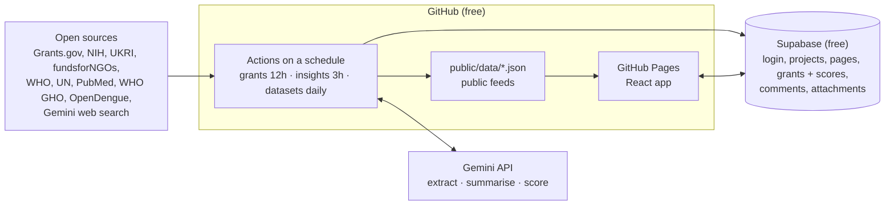

# WAIG Atlas

Proof of concept for Wadhwani AI Global: a funds & grants directory, a global open health datasets view, latest public-health insights, and Notion-style project dashboards with configurable milestones.

**Live:** https://rohit-singh-wadhwani.github.io/waig-atlas/ (sign in with a @wadhwaniaiglobal.com email)

## How it fits together



- **Public data** (grant listings without scores, insights, health indicators, source status) is committed to `public/data` by the scheduled jobs and served with the site.
- **Private data** (suitability scores, assignees, milestones, project pages, comments, attachments) lives in Supabase behind row-level security: only signed-in users with a `@wadhwaniaiglobal.com` email can read or write.

## Sections

| Section | What it does |
| --- | --- |
| Funds & Grants | Map of open calls by eligible country; latest deals; directory with amount, deadline, eligibility, Gemini suitability score (strengths and weaknesses), assignee, self-managed milestones (Submission → Review 1 → Review 2 → Grant), comments and attachments |
| Health Map | Choropleth of open indicators (WHO GHO: TB, malaria, cholera, measles, HIV; OpenDengue) by year, with WHO outbreak alerts layered on |
| Latest Insights | WHO/UN news, outbreak notices, PubMed research, social posts, tenders; summarised and tagged by Gemini |
| Sources & Status | Every feed, on/off switch, last run, item count and error message; add new sources |
| Projects | One page per project: KPIs, dashboard links, milestone Gantt, per-team progress, tasks, attachments, discussion; each milestone has its own block-editable page with Mermaid diagrams |
| Milestone Templates | Configurable milestones and sections new projects start from |
| Org Context | What Gemini knows about WAIG when it scores grants |

## Setup (one time)

1. **Repo secrets** (Settings → Secrets and variables → Actions): `GEMINI_API_KEY`, `SUPABASE_SERVICE_ROLE_KEY`.
2. **Pages:** Settings → Pages → Source: GitHub Actions.
3. **Supabase auth:** Authentication → URL Configuration → Site URL and Redirect URLs = the Pages URL above.
4. Run **Actions → Refresh data and deploy → Run workflow** once to fetch everything.

Schema: [`supabase/schema.sql`](supabase/schema.sql). Sources: [`config/sources.json`](config/sources.json) (copied into Supabase on the first run; edit them in the app afterwards).

## Local development

```bash
npm install
npm start            # uses .env.production values for Supabase
node scripts/fetch-health.mjs     # needs network; GEMINI_API_KEY and SUPABASE_SERVICE_ROLE_KEY optional
```
